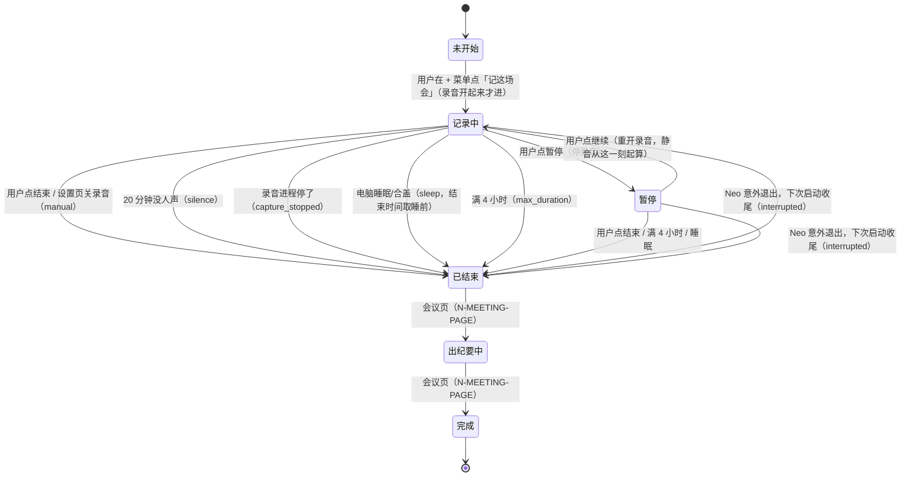

# 记这场会（会议记录状态机）

一场会 = `desktop-activity.sqlite3` 里 `meetings` 表的一行：标题、开始/结束时间、状态、结束原因。这场会的转写就是起止时间内的 `audio_segments`。段落时间是按样本数推算的，所以准；段落上不另打会议号。

- 主机：`src/host/services/desktop/meetingSession.ts`（状态与自动结束）、`src/host/ipc/desktop.ipc.ts`（`startMeeting` / `pauseMeeting` / `resumeMeeting` / `stopMeeting` / `getMeetingStatus` / `listMeetings`）
- 界面：输入框「+」菜单「记这场会」，录制中由输入框上方的录制条（`MeetingBar`）操作
- 阈值：`MEETING_SESSION_LIMITS`（`src/shared/constants/desktopAudio.ts`）

## 状态机

「出纪要中」「完成」由会议页那张单（N-MEETING-PAGE）实现，本单只到「已结束」。

## 规则

- **只由用户手动开始**。不按会议软件或日历自动开录：自动拉起 ScreenCaptureKit 会被 macOS 标成「屏幕共享」（`desktop.ipc.ts` 顶部注释）。日历只提醒（另一个 PR）。
- 开始前，菜单项写着「开始前先征得参会人同意」。Neo 不替用户通知别人。
- 静音：连续 10 分钟没有转写出人声时提醒（录制条变黄），20 分钟自动结束。暂停期间不计静音。
- 睡眠：巡检每 30 秒一次，两次巡检间隔超过 2 分钟，就判为睡眠过，结束时间取睡前那次巡检的时刻。
- 记录中每次巡检写一次心跳（`updated_at_ms`）。Neo 意外退出后，下次用到时把没走完的会收尾为 `interrupted`，结束时间取最后一次心跳。
- 没开过桌面活动采集器、录音库文件不存在时，开始录音会先建库，避免转写只落 wav、不入库。
