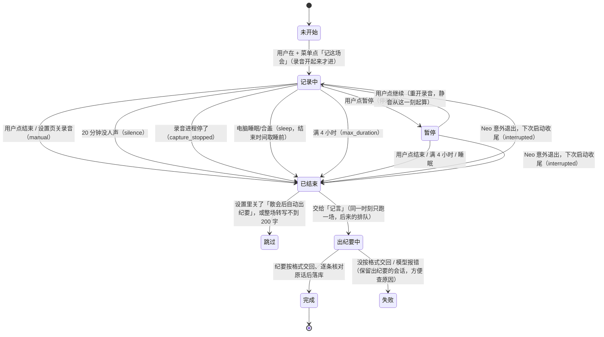

# 记这场会（会议记录状态机）

一场会 = `desktop-activity.sqlite3` 里 `meetings` 表的一行：标题、开始/结束时间、状态、结束原因。这场会的转写就是起止时间内的 `audio_segments`。段落时间是按样本数推算的，所以准；段落上不另打会议号。

- 主机：`src/host/services/desktop/meetingSession.ts`（状态与自动结束）、`src/host/ipc/desktop.ipc.ts`（`startMeeting` / `pauseMeeting` / `resumeMeeting` / `stopMeeting` / `getMeetingStatus` / `listMeetings`）
- 界面：输入框「+」菜单「记这场会」，录制中由输入框上方的录制条（`MeetingBar`）操作
- 阈值：`MEETING_SESSION_LIMITS`（`src/shared/constants/desktopAudio.ts`）

## 状态机



纪要部分由会议页那张单（N-MEETING-PAGE）实现，代码在 `src/host/services/desktop/meetingMinutes.ts`，存在 meetings 表的 `minutes_state` / `minutes_json` / `minutes_session_id` 列。

## 规则

- **只由用户手动开始**。不按会议软件或日历自动开录：自动拉起 ScreenCaptureKit 会被 macOS 标成「屏幕共享」（`desktop.ipc.ts` 顶部注释）。日历只提醒（另一个 PR）。
- 开始前，菜单项写着「开始前先征得参会人同意」。Neo 不替用户通知别人。
- 静音：连续 10 分钟没有转写出人声时提醒（录制条变黄），20 分钟自动结束。暂停期间不计静音。
- 睡眠：巡检每 30 秒一次，两次巡检间隔超过 2 分钟，就判为睡眠过，结束时间取睡前那次巡检的时刻。
- 记录中每次巡检写一次心跳（`updated_at_ms`）。Neo 意外退出后，下次用到时把没走完的会收尾为 `interrupted`，结束时间取最后一次心跳。
- 没开过桌面活动采集器、录音库文件不存在时，开始录音会先建库，避免转写只落 wav、不入库。

## 会后纪要（N-MEETING-PAGE）

- 会议任何原因结束都会入队；开关是设置里的「散会后自动出纪要」（`settings.meeting.autoMinutes`，缺省开）。每场调一次模型、会产生费用；转写不到 `MEETING_SESSION_LIMITS.MINUTES_MIN_TRANSCRIPT_CHARS` 字直接跳过，不调模型。
- 记言在一条单独的会话里跑（标题「会议纪要：<会议名>」），只给 `meeting_records` 一个只读工具，最多 `MINUTES_MAX_ITERATIONS` 轮，按 ```` ```meeting_minutes ```` JSON 交回决策 / 行动项 / 未解问题，每条带原话出处。
- 宿主逐条核对：原话出处在转写里找不到的整条丢掉；负责人、截止时间只有那句原话里明说了才保留，否则置空，会议页显示「待认领 / 待定」，只列不派。妙记和腾讯会议 AI 判的负责人不作为来源。
- 意外退出后由下次启动收尾为 interrupted 的会不自动出纪要（收尾是一条 SQL，没有逐场回调）。
